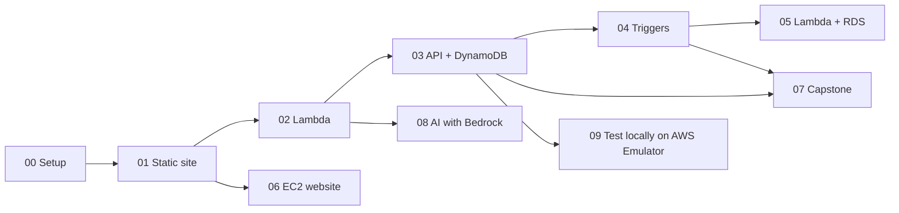

# AWS Foundations Labs

Hands-on labs that take you from "what is AWS?" to building the back end of a real product.
Every lab builds one skill **three ways**, so you see what each tool does for you:

| Path | How | Why |
|------|-----|-----|
| **A · Console** | Click through the AWS console | See every piece and every setting |
| **B · CloudFormation** | Deploy one YAML template | Repeatable, reviewable infrastructure as code |
| **C · CDK** | `npx cdk deploy <Lab>` from Python | The same, with a real programming language |

Everything is **Python**: the Lambda functions (Python 3.13, boto3), the CDK stacks, the helper scripts
and the tests. The Lambda code is shared by the three paths: you write it once in `labs/*/src/`.

## The labs

| # | Lab | You build | AWS services | Time | Cost while running |
|---|-----|-----------|--------------|------|--------------------|
| 00 | [Setup](labs/00-setup/) | A safe account and your tools | IAM, Budgets, CLI | 30 min | $0 |
| 01 | [Static website](labs/01-static-website/) | Your site on HTTPS, bucket private | S3, CloudFront | 30 min | ≈ $0 |
| 02 | [Lambda basics](labs/02-lambda-basics/) | Your first function, with a public URL | Lambda, CloudWatch Logs | 30 min | $0 |
| 03 | [API + database](labs/03-api-dynamodb/) | A REST API for notes | API Gateway, Lambda, DynamoDB | 45 min | ≈ $0 |
| 04 | [Event triggers](labs/04-event-triggers/) | Code that runs when things happen | S3 events, SQS + DLQ, EventBridge, SNS | 60 min | ≈ $0 |
| 05 | [Lambda + RDS](labs/05-lambda-rds/) | Lambda talking to PostgreSQL, privately | VPC, security groups, RDS, Secrets Manager | 60 min | ≈ $0.04/hour |
| 06 | [Website on EC2](labs/06-ec2-website/) | One server, then a self-healing fleet | EC2, user data, Session Manager, ALB, Auto Scaling | 60 min | ≈ $0.05/hour |
| 07 | [Capstone](labs/07-capstone/) | Your site grown into an app, in 3 stages | All of the above, with the CDK | 60 min | ≈ $0 |
| 08 | [Add AI](labs/08-ai-bedrock/) | An "ask me" assistant for your site | Bedrock, Lambda | 30 min | cents |
| 09 | [AWS Emulator](labs/09-aws-emulator/) | AWS on your laptop: run and test your Lambda code locally | AWS Emulator, S3, DynamoDB, SQS | 45 min | $0, no account |

Labs 01–04 and 07 fit in the Free Tier credits easily. **Labs 05 and 06 cost money every hour they run:
delete them when you finish.**



## Repository layout

```
site/                 the personal website used by labs 01, 06 and 07
labs/NN-name/
  README.md           the lab guide: console, CloudFormation and CDK paths, fixes, clean up
  src/                Lambda code: lambda_function.py (the same for all three paths)
  events/             test events to paste into the Lambda console
  cloudformation/     the lab as one template
cdk/                  one CDK app (app.py) with one stack per lab (stacks/)
scripts/deploy_cfn.py deploys any lab template (packages the Lambda code for you)
tests/                pytest unit tests for every Lambda function (no AWS account needed)
tests/integration/    the same code against AWS Emulator (lab 09)
requirements-dev.txt  what you need locally: boto3, pytest, cfn-lint, ruff
amplify.yml           Amplify Hosting settings for the website (lab 01, path D)
```

## Quick start

```bash
git clone https://github.com/<you>/aws-foundations-labs.git
cd aws-foundations-labs
python -m venv .venv && source .venv/bin/activate   # Windows: .venv\Scripts\activate
pip install -r requirements-dev.txt
pytest                      # 23 unit tests, all offline (emulator tests skip)

aws login                   # see labs/00-setup
cd cdk
pip install -r requirements.txt && npm install      # CDK library (Python) + cdk command (npm)
npx cdk bootstrap           # once per account and Region
npx cdk deploy Lab02LambdaBasics
```

## Rules for every lab

1. **One Region** for everything. Check the Region menu before each step.
2. **Free plan + a budget alert** before you start ([lab 00](labs/00-setup/)).
3. **No access keys** in code, chat, Git or screenshots. Use `aws login`.
4. **Read before you approve**: `cdk diff` and the CloudFormation change set show what will change.
5. **Clean up** at the end of every lab. Each guide ends with the exact commands.

## Use it with an AI coding agent

Install the official AWS skills (`aws configure agent-toolkit`, or in Claude Code
`/plugin install aws-core@claude-plugins-official`), open this folder, and ask:

> Read labs/04-event-triggers and explain how each trigger works. Then add a CloudWatch alarm on errors.

The agent writes the code; you review the diff and approve the deploy.

## License

MIT-0 (see `LICENSE`): copy, change and use it for your own products, no attribution needed.
