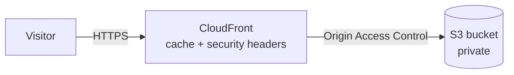

# Lab 01 · Static website: S3 + CloudFront

> Put the personal website in `site/` on the internet, over HTTPS, with the bucket kept private.
> Time: 30 minutes · Cost: ≈ $0 (CloudFront Free plan or a few cents of S3)



**You'll learn:** S3 buckets and objects · CloudFront and edge locations · Origin Access Control ·
bucket policies (resource-based policies) · cache invalidation · infrastructure as code.

## Path A · Console

1. **S3** → **Create bucket** → General purpose → a unique name like `yourname-site-2026` → keep **Block all public access** ON → **Create bucket**.
2. Open the bucket → **Upload** → add everything inside `site/` (so `index.html` is at the top level) → **Upload**.
3. **CloudFront** → **Create distribution** → plan: **Free** → name it → **Single website** → Next.
4. **Origin type: Amazon S3** → **Browse S3** → your bucket → keep **Allow private S3 bucket access to CloudFront** ticked → recommended settings → Next → keep the security defaults → **Create distribution**.
5. Wait a few minutes, then open `https://<distribution domain>`.
6. Optional: distribution → **Error pages** → **Create custom error response**: 403 → `/404.html`, response code 404.

**Update the site from the terminal** (works for any bucket and distribution):

```bash
python labs/01-static-website/cli/deploy.py <bucket-name> <distribution-id>
```

## Path B · CloudFormation

The template creates the bucket, the Origin Access Control, the distribution (with security headers and the 404 page) and a bucket policy that lets only that distribution read.

```bash
aws cloudformation deploy \
  --template-file labs/01-static-website/cloudformation/static-site.yaml \
  --stack-name lab01-static-site

# read the outputs, then upload the site
aws cloudformation describe-stacks --stack-name lab01-static-site --query "Stacks[0].Outputs" --output table
python labs/01-static-website/cli/deploy.py <BucketName> <DistributionId>
```

Or in the console: **CloudFormation** → **Create stack** → **Upload a template file** → `static-site.yaml`.

## Path C · CDK

```bash
cd cdk
npx cdk diff Lab01StaticSite
npx cdk deploy Lab01StaticSite     # also uploads site/ and clears the cache
```

Read [`cdk/stacks/lab01_static_site.py`](../../cdk/stacks/lab01_static_site.py): about 40 lines replace the whole template.

## Path D · Amplify Hosting (git push to deploy)

Push this repository to GitHub → **Amplify** → **Create new app** → GitHub → pick the repo →
tick **My app is a monorepo**, app root `site` → Amplify reads [`amplify.yml`](../../amplify.yml) → **Save and deploy**.
Every `git push` now publishes a new version.

## Test it

- The site loads at the `https://…cloudfront.net` address.
- The S3 object URL (bucket → `index.html` → **Object URL**) says **Access Denied**: the bucket is private, as it should be.
- `https://…cloudfront.net/does-not-exist` shows your 404 page.

## Fix it

| You see | Cause | Fix |
|---------|-------|-----|
| `AccessDenied` XML at the root URL | No default root object | Distribution → Settings → Edit → Default root object = `index.html` |
| `AccessDenied` on every page | Bucket policy doesn't name this distribution | Copy the policy from the distribution's Origins tab into the bucket policy |
| Old version after an upload | CloudFront cache | `deploy.py` invalidates `/*`; or create the invalidation by hand |
| Bucket name already taken | Names are global | Add your name and a number |
| Site works on HTTP only | You used the S3 website endpoint as origin | Choose the bucket itself, not the website endpoint |

## Clean up

```bash
aws cloudformation delete-stack --stack-name lab01-static-site     # Path B (empty the bucket first)
npx cdk destroy Lab01StaticSite                                     # Path C (empties the bucket for you)
```
Console: empty and delete the bucket; **Disable**, then **Delete** the distribution; delete the Amplify app.

## Go further

- Add a custom domain: register it in **Route 53**, request a free certificate in **ACM** (us-east-1), add it to the distribution.
- Compare with lab 06, where the same site runs on EC2 servers.
