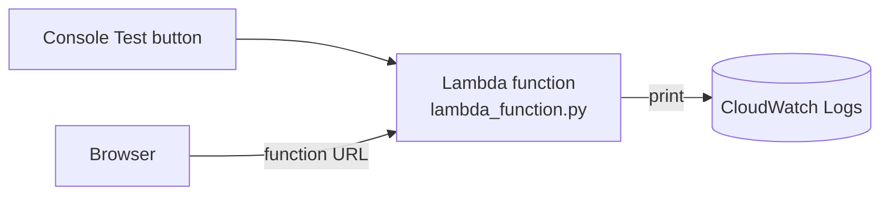

# Lab 02 · Lambda basics: your first function

> Write a function, run it from the console, give it a public URL, read its logs.
> Time: 30 minutes · Cost: $0 (1 million requests a month are always free)



**You'll learn:** what a function, a handler and an event are · environment variables ·
execution roles (what the function may do) · function URLs · CloudWatch Logs · memory, timeout and cold starts.

Code: [`src/lambda_function.py`](src/lambda_function.py) · Test event: [`events/test-event.json`](events/test-event.json)

## Path A · Console

1. **Lambda** → **Create function** → **Author from scratch**.
   - Name `hello-lambda`, runtime **Python 3.13**, architecture **arm64** (about 20% cheaper).
   - Permissions: keep **Create a new role with basic Lambda permissions** (it can write logs, nothing else).
   - **Create function**.
2. **Code** tab: replace everything in `lambda_function.py` with [`src/lambda_function.py`](src/lambda_function.py) → **Deploy**. (The console already uses this file name and the handler `lambda_function.lambda_handler`.)
3. **Test** tab: new event named `dana`, paste [`events/test-event.json`](events/test-event.json) → **Test**. You see `Hello, Dana!`, the duration and the memory used.
4. **Configuration** → **Environment variables** → add `GREETING` = `Marhaba` → Save → test again.
5. **Configuration** → **Function URL** → **Create** → Auth type **NONE** → Save. Open the URL with `?name=YourName`.
6. **Monitor** → **View CloudWatch logs**: one log stream per running copy of your function; your `print()` lines are there.

## Path B · CloudFormation

```bash
python scripts/deploy_cfn.py labs/02-lambda-basics/cloudformation/lambda-basics.yaml lab02-hello Greeting=Marhaba
```

The script zips `src/`, uploads it, and deploys [`lambda-basics.yaml`](cloudformation/lambda-basics.yaml):
the role, the function, a log group that keeps logs for 7 days, the function URL and its permissions.

## Path C · CDK

```bash
cd cdk && npx cdk deploy Lab02LambdaBasics
```

## Test it from the terminal

```bash
aws lambda invoke --function-name <FunctionName> \
  --payload file://labs/02-lambda-basics/events/test-event.json \
  --cli-binary-format raw-in-base64-out out.json && cat out.json

curl "<FunctionUrl>?name=Omar"
aws logs tail /aws/lambda/<FunctionName> --follow      # console path; CFN/CDK: see the log group in the stack
```

## Fix it

| You see | Cause | Fix |
|---------|-------|-----|
| `Unable to import module 'lambda_function'` | File isn't named `lambda_function.py`, or handler setting changed | Runtime settings → Handler = `lambda_function.lambda_handler` |
| `Task timed out after 3.00 seconds` | Default timeout is 3 s | Configuration → General → Timeout |
| Function URL says `Forbidden` | Missing resource-based permission | Recreate the URL with auth NONE, or check the two permissions in the template |
| Changes don't run | Edited but not deployed | Click **Deploy** before **Test** |
| No logs | Role can't write logs | Role needs `AWSLambdaBasicExecutionRole` |

## Clean up

```bash
aws cloudformation delete-stack --stack-name lab02-hello    # Path B
npx cdk destroy Lab02LambdaBasics                            # Path C
```
Console: delete the function, its role in IAM, and its log group in CloudWatch.

## Go further

- Raise memory to 1024 MB and compare the duration: Lambda gives more CPU with more memory.
- Read about cold starts: the first request after a pause is slower.
