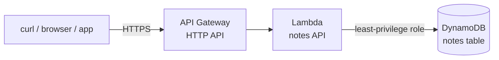

# Lab 03 · API + database: API Gateway → Lambda → DynamoDB

> Build a real REST API for notes: create, list, read and delete, saved in a database.
> Time: 45 minutes · Cost: ≈ $0 at lab traffic



| Method | Path | Does |
|--------|------|------|
| GET | `/notes` | List notes, newest first |
| POST | `/notes` | Create `{"title": "...", "text": "..."}` |
| GET | `/notes/{id}` | Read one note |
| DELETE | `/notes/{id}` | Delete one note |

**You'll learn:** NoSQL tables and keys · on-demand billing · IAM policies scoped to one table ·
API Gateway routes and integrations · resource-based permissions · CORS · HTTP status codes.

Code: [`src/index.mjs`](src/index.mjs) · Test event: [`events/create-note.json`](events/create-note.json)

## Path A · Console

1. **DynamoDB** → **Create table** → name `notes`, partition key `id` (String) → **Default settings** (on-demand) → **Create table**.
2. **Lambda** → create `notes-api` (Node.js 22.x, arm64) → paste [`src/index.mjs`](src/index.mjs) → **Deploy**.
3. **Configuration** → **Environment variables** → `TABLE_NAME` = `notes`. **General configuration** → timeout 10 s.
4. **Permissions**: **Configuration** → **Permissions** → click the role → **Add permissions** → **Create inline policy** → JSON:
   ```json
   {
     "Version": "2012-10-17",
     "Statement": [{
       "Effect": "Allow",
       "Action": ["dynamodb:GetItem", "dynamodb:PutItem", "dynamodb:DeleteItem", "dynamodb:Scan", "dynamodb:Query"],
       "Resource": "arn:aws:dynamodb:<region>:<account-id>:table/notes"
     }]
   }
   ```
   (Copy the table's ARN from DynamoDB → notes → **General information**.)
5. **Test** with [`events/create-note.json`](events/create-note.json): status 201. Check **DynamoDB** → notes → **Explore table items**.
6. **API Gateway** → **Create API** → **HTTP API** → **Build** → integration: **Lambda**, `notes-api` → name `notes` → routes:
   `GET /notes`, `POST /notes`, `GET /notes/{id}`, `DELETE /notes/{id}` → stage `$default` (auto-deploy) → **Create**.
   API Gateway adds the permission to call your function for you.
7. **CORS** (so a website can call it): API → **CORS** → origin `*`, methods GET, POST, DELETE, header `content-type`.

## Path B · CloudFormation

```bash
./scripts/deploy-cfn.sh labs/03-api-dynamodb/cloudformation/api-dynamodb.yaml lab03-notes
```

[`api-dynamodb.yaml`](cloudformation/api-dynamodb.yaml) uses the HTTP API "quick create": one resource gives the API,
a catch-all route, the integration and a deployed stage. The function handles the routing itself.

## Path C · CDK

```bash
cd cdk && npx cdk deploy Lab03ApiDynamoDb
```
`table.grantReadWriteData(fn)` writes the least-privilege policy from step 4 for you.

## Test it

```bash
API=<ApiUrl>
curl -s -X POST "$API/notes" -H 'content-type: application/json' -d '{"title":"Buy milk","text":"2 litres"}'
curl -s "$API/notes"
curl -s "$API/notes/<id>"
curl -s -X DELETE "$API/notes/<id>" -o /dev/null -w "%{http_code}\n"     # 204
```

## Fix it

| You see | Cause | Fix |
|---------|-------|-----|
| `{"message":"Not Found"}` from API Gateway | No route matches | Check the routes, including `/notes/{id}` |
| `Internal error, check the CloudWatch logs` | The function threw | Monitor → logs; often `AccessDeniedException` (step 4) or missing `TABLE_NAME` |
| `AccessDeniedException ... dynamodb:PutItem` | Role policy missing or wrong ARN | Fix the inline policy's Resource |
| `ResourceNotFoundException` | Wrong table name or Region | `TABLE_NAME` must match exactly; same Region |
| Browser says CORS error | CORS not set on the API | Step 7 |

## Clean up

```bash
aws cloudformation delete-stack --stack-name lab03-notes      # Path B
npx cdk destroy Lab03ApiDynamoDb                               # Path C
```
Console: delete the API, the function (and its role), and the table.

## Go further

- Add `PUT /notes/{id}` to edit a note (`UpdateCommand`).
- Replace `Scan` with a `Query` on a key like `userId` once notes belong to users (Cognito).
- Add API throttling: Stage → **Throttling** → 10 requests/second.
