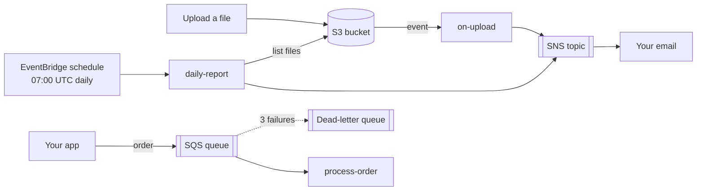

# Lab 04 · Event triggers: code that runs when something happens

> Three triggers, three patterns every product uses: a file upload, a queue of jobs, and a schedule.
> Time: 60 minutes · Cost: ≈ $0 at lab traffic



| Trigger | Function | Pattern |
|---------|----------|---------|
| S3 upload | [`src/on-upload`](src/on-upload/lambda_function.py) | React to new files: thumbnails, scans, imports |
| SQS queue | [`src/process-order`](src/process-order/lambda_function.py) | Do work in the background, retry failures, park bad messages |
| Schedule | [`src/daily-report`](src/daily-report/lambda_function.py) | Cron jobs: reports, clean-ups, reminders |

**You'll learn:** event-driven design · S3 event notifications · SNS topics and subscriptions · SQS queues,
visibility timeout, retries and dead-letter queues · partial batch failures · EventBridge schedules ·
loose coupling (the uploader doesn't know the function exists).

## Path A · Console

**Shared: an SNS topic**
1. **SNS** → **Topics** → **Create topic** → Standard → name `lab04-notifications` → Create.
2. **Create subscription** → protocol **Email** → your address → open the confirmation email and click **Confirm subscription**.

**Trigger 1: S3 → Lambda → SNS**
1. **S3** → create bucket `lab04-uploads-<yourname>` (private).
2. **Lambda** → create `on-upload` (Python 3.13, arm64), paste [`src/on-upload/lambda_function.py`](src/on-upload/lambda_function.py), Deploy.
   Environment variable `TOPIC_ARN` = your topic's ARN.
3. Role → add an inline policy: `s3:GetObject` on `arn:aws:s3:::lab04-uploads-<yourname>/*` and `sns:Publish` on the topic ARN.
4. **Add trigger** → **S3** → your bucket → event type **All object create events** → acknowledge → Add.
5. Upload any file to the bucket. Within seconds you get an email, and the log shows `New upload: …`.

**Trigger 2: SQS → Lambda, with a dead-letter queue**
1. **SQS** → create queue `orders-dlq` (Standard).
2. Create queue `orders` → **Visibility timeout** 60 s → **Dead-letter queue**: enable, `orders-dlq`, **Maximum receives** 3.
3. **Lambda** → create `process-order`, paste [`src/process-order/lambda_function.py`](src/process-order/lambda_function.py), Deploy.
   Role → attach the managed policy **AWSLambdaSQSQueueExecutionRole**.
4. **Add trigger** → **SQS** → `orders` → batch size 10 → tick **Report batch item failures** → Add.
5. SQS → `orders` → **Send and receive messages** → body = [`events/order-good.json`](events/order-good.json) → Send. The log shows the total.
6. Send [`events/order-bad.json`](events/order-bad.json): it fails 3 times, then appears in `orders-dlq` (**Poll for messages** there).

**Trigger 3: a schedule**
1. **Lambda** → create `daily-report`, paste [`src/daily-report/lambda_function.py`](src/daily-report/lambda_function.py), Deploy.
   Environment: `BUCKET_NAME` = your uploads bucket, `TOPIC_ARN` = your topic. Timeout 30 s.
   Role → inline policy: `s3:ListBucket` on `arn:aws:s3:::lab04-uploads-<yourname>` and `sns:Publish` on the topic.
2. **Add trigger** → **EventBridge (CloudWatch Events)** → new rule `daily-report` → **Schedule expression** `rate(5 minutes)` for the demo → Add.
3. Wait 5 minutes: you get the report by email. Then change the rule to `cron(0 7 * * ? *)` (07:00 UTC daily) or disable it.

## Path B · CloudFormation

```bash
python scripts/deploy_cfn.py labs/04-event-triggers/cloudformation/event-triggers.yaml lab04-triggers \
  NotificationEmail=you@example.com ReportSchedule="rate(5 minutes)"
```
Confirm the subscription email. Note in [`event-triggers.yaml`](cloudformation/event-triggers.yaml) how the bucket name is
built with `!Sub` so the bucket, the function and the permission don't depend on each other in a circle.

## Path C · CDK

```bash
cd cdk && npx cdk deploy Lab04EventTriggers -c email=you@example.com
```

## Test it from the terminal

```bash
aws s3 cp site/favicon.svg s3://<UploadsBucket>/
aws sqs send-message --queue-url <OrdersQueueUrl> --message-body file://labs/04-event-triggers/events/order-good.json
aws sqs send-message --queue-url <OrdersQueueUrl> --message-body file://labs/04-event-triggers/events/order-bad.json
aws sqs get-queue-attributes --queue-url <DeadLetterQueueUrl> --attribute-names ApproximateNumberOfMessages   # about 3 minutes later: 1 (3 tries, 60 s apart)
aws lambda invoke --function-name <daily-report function> out.json && cat out.json                            # run the report now
```

## Fix it

| You see | Cause | Fix |
|---------|-------|-----|
| Upload doesn't trigger anything | Trigger missing, or wrong bucket/Region | Function → Configuration → Triggers |
| No email | Subscription not confirmed | SNS → Subscriptions: status must be **Confirmed** |
| `AccessDenied ... HeadObject` | Role can't read the bucket | Add `s3:GetObject` on `bucket/*` |
| Same order processed again and again | Function fails, no DLQ | Set the redrive policy (max receives 3) |
| Whole batch retried for one bad message | Partial failures off | Tick **Report batch item failures** |
| Upload → function writes to the same bucket → loop | Function triggered by its own output | Never write back to the triggering bucket (or use a prefix filter) |
| `CREATE_FAILED ... circular dependency` (CloudFormation) | `!Ref` to the bucket in the permission | Build the bucket ARN with `!Sub` as the template does |

## Clean up

```bash
aws s3 rm s3://lab04-uploads-<account>-<region> --recursive && aws cloudformation delete-stack --stack-name lab04-triggers
npx cdk destroy Lab04EventTriggers
```
Console: delete the three functions, the rule, both queues, the topic and the bucket (empty it first).

## Go further

- Add a CloudWatch **alarm** on the DLQ's `ApproximateNumberOfMessagesVisible` > 0 that emails the topic.
- Save orders in DynamoDB (lab 03) from `process-order`.
- Use an S3 **prefix filter** (`uploads/`) so only one folder triggers the function.
