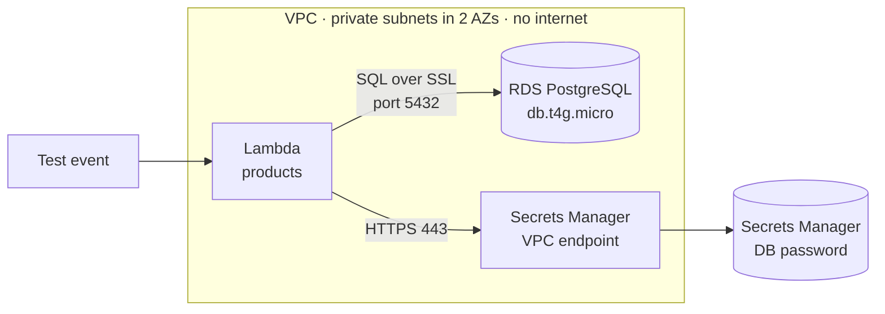

# Lab 05 · Lambda + RDS: talk to a relational database, privately

> Connect a Lambda function to PostgreSQL in Amazon RDS the professional way: private network,
> security groups, password in Secrets Manager, SSL, parameterised SQL.
> Time: 60 minutes · **Cost: about $0.04/hour while it runs. Delete it the same day.**



**You'll learn:** VPCs and private subnets · security groups that reference each other · RDS and DB subnet groups ·
Secrets Manager (no passwords in code) · VPC endpoints · Lambda in a VPC · connection reuse · SQL injection protection.

Code: [`src/index.mjs`](src/index.mjs) · SQL: [`sql/schema.sql`](sql/schema.sql) · Events: [`events/`](events/)

The function needs the `pg` driver, so its code is a folder with `node_modules`, not one file.
All three paths start with:

```bash
cd labs/05-lambda-rds/src && npm ci --omit=dev && cd -
```

## Path A · Console

1. **RDS** → **Create database** → **Standard create** → **PostgreSQL** (version 17) → template **Free tier**.
   - Identifier `lab05-db` · master username `postgres` · **Credentials management: Managed in AWS Secrets Manager**.
   - Instance `db.t4g.micro` · storage 20 GB gp3.
   - Connectivity: default VPC · **Public access: No** · new security group `lab05-db-sg`.
   - Additional configuration → **Initial database name** `shop` → **Create database** (about 10 minutes).
2. **Package the code:** `./labs/05-lambda-rds/scripts/package.sh` → creates `labs/05-lambda-rds/function.zip`.
3. **Lambda** → create `products` (Node.js 22.x, arm64) → **Code** → **Upload from** → **.zip file** → `function.zip`.
   - **Configuration** → **General**: memory 256 MB, timeout 15 s.
   - **Environment variables**:

     | Key | Value |
     |-----|-------|
     | `DB_HOST` | RDS → lab05-db → **Endpoint** |
     | `DB_NAME` | `shop` |
     | `SECRET_ARN` | RDS → lab05-db → Configuration → **Master credentials ARN** |
     | `NODE_EXTRA_CA_CERTS` | `/var/runtime/ca-cert.pem` |
4. **Connect them:** RDS → lab05-db → **Actions** → **Set up Lambda connection** → existing function `products` →
   no RDS Proxy → **Set up**. This puts the function in the database's VPC and adds the security group rules for port 5432.
5. **Let the function read the secret:** Lambda → Configuration → Permissions → role → **Create inline policy**:
   `secretsmanager:GetSecretValue` on the secret ARN from step 3.
6. **Private route to Secrets Manager:** **VPC** → **Endpoints** → **Create endpoint** → AWS services →
   `com.amazonaws.<region>.secretsmanager` → VPC: default → the same subnets as the function → new security group
   allowing **HTTPS 443** from the function's security group → **Enable private DNS** → Create.
   (The function has no internet inside a VPC; this endpoint is its private door. About $0.01/hour per AZ.)
7. **Test** in this order: [`events/init.json`](events/init.json), [`events/add.json`](events/add.json) (a few times, change the name),
   [`events/list.json`](events/list.json).

## Path B · CloudFormation

```bash
./scripts/deploy-cfn.sh labs/05-lambda-rds/cloudformation/lambda-rds.yaml lab05-rds
```
[`lambda-rds.yaml`](cloudformation/lambda-rds.yaml) builds everything from steps 1–6 in its own private VPC
(about 10 minutes, mostly the database). Read the security groups: the database only accepts the function's group,
the endpoint only accepts HTTPS from the function's group.

## Path C · CDK

```bash
cd cdk && npx cdk deploy Lab05LambdaRds
```
In [`lab05-lambda-rds-stack.ts`](../../cdk/lib/lab05-lambda-rds-stack.ts), two lines replace steps 4–5:
`db.connections.allowDefaultPortFrom(fn)` and `db.secret.grantRead(fn)`.

## Test it from the terminal

```bash
for e in init add list; do
  aws lambda invoke --function-name <FunctionName> --cli-binary-format raw-in-base64-out \
    --payload file://labs/05-lambda-rds/events/$e.json out.json && cat out.json && echo
done
```

## Fix it

| You see | Cause | Fix |
|---------|-------|-----|
| `Task timed out` on every call | No network path: endpoint missing, or security group blocks it | Step 6; endpoint SG must allow 443 from the function's SG |
| `timeout expired` / `Connection terminated` | Database SG doesn't allow the function | Step 4, or add inbound 5432 from the function's SG |
| `self-signed certificate in certificate chain` | Node can't verify the RDS certificate | `NODE_EXTRA_CA_CERTS=/var/runtime/ca-cert.pem` |
| `no pg_hba.conf entry ... no encryption` | Connected without SSL | Keep `ssl: { rejectUnauthorized: true }` in the code |
| `password authentication failed` | Secret rotated or wrong secret ARN | Use the **Master credentials ARN** from RDS |
| `Cannot find package 'pg'` | Uploaded `index.mjs` alone | Upload the zip from `package.sh` |
| `...not have permissions to call CreateNetworkInterface` | Role lacks VPC permissions | Attach **AWSLambdaVPCAccessExecutionRole** |
| `relation "products" does not exist` | Table not created | Run the `init` event first |
| `too many connections` under load | Each function copy opens a connection | Keep `max: 1`; at scale use **RDS Proxy** |

## Clean up (do it today)

```bash
aws cloudformation delete-stack --stack-name lab05-rds      # Path B, about 10 minutes
npx cdk destroy Lab05LambdaRds                               # Path C
```
Console: delete the database (no final snapshot), the VPC endpoint, the function, and the security groups.
Then check **Billing** → nothing named RDS or VPC endpoint still running.

## Go further

- Turn on **Multi-AZ**: a standby in a second AZ that takes over automatically (doubles the cost).
- Put **RDS Proxy** between Lambda and the database to pool connections.
- Query the database yourself from **CloudShell** in a VPC environment with `psql`.
