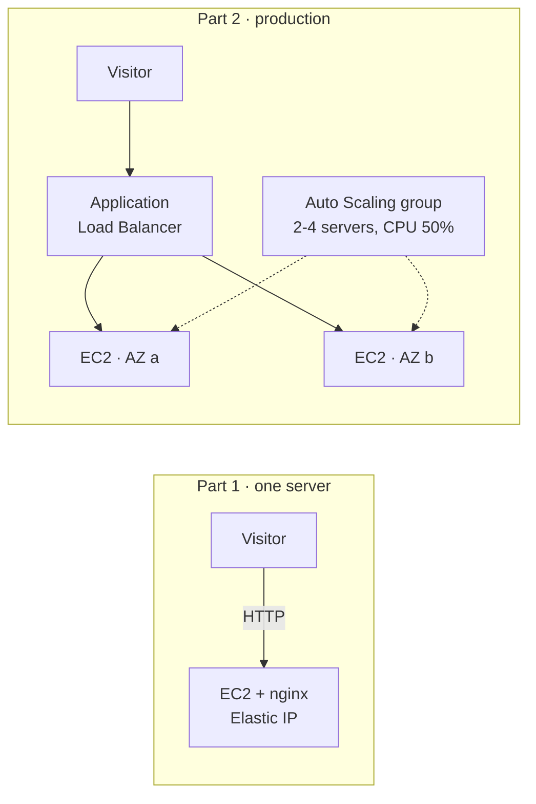

# Lab 06 · Website on EC2: one server, then a self-healing fleet

> Run the same website on your own Linux server with nginx, fix the classic problems,
> then make it production-ready with a load balancer and Auto Scaling across two AZs.
> Time: 60 minutes · **Cost: part 1 ≈ $0.02/hour, part 2 ≈ $0.05/hour. Delete when done.**



**You'll learn:** EC2 instances, AMIs and instance types · user data (boot scripts) · security groups ·
IAM roles for servers · Session Manager instead of SSH · IMDSv2 · Elastic IPs · Application Load Balancers,
target groups and health checks · Auto Scaling · why serverless (labs 01–04) needs none of this.

Files: [`user-data.sh`](user-data.sh) (the boot script) · [`cloudformation/`](cloudformation/)

**Before you start:** fork this repository on GitHub (public), and in your fork edit the `REPO_URL` line
of `user-data.sh` to your fork's URL. The server clones your site from there.

## Part 1 · One server

### Path A · Console

1. **IAM** → **Roles** → **Create role** → AWS service **EC2** → policy **AmazonSSMManagedInstanceCore** → name `lab06-ec2-ssm`.
2. **EC2** → **Launch instances**:
   - Name `lab06-web` · **Amazon Linux 2023** · `t3.micro` (Free tier eligible).
   - Key pair: **Proceed without a key pair** (we use Session Manager, no SSH).
   - Network settings → **Edit** → auto-assign public IP **Enable** → create security group `lab06-web-sg`:
     remove the SSH rule, add **HTTP, port 80, Anywhere**.
   - Advanced details → IAM instance profile `lab06-ec2-ssm` → **Metadata version: V2 only (token required)** →
     **User data**: paste your edited `user-data.sh` → **Launch instance**.
3. Wait 2–3 minutes, then open `http://<Public IPv4 address>` (http, not https).
4. **Look inside:** select the instance → **Connect** → **Session Manager** → Connect:
   ```bash
   sudo tail -n 30 /var/log/cloud-init-output.log   # what user data did
   systemctl status nginx --no-pager
   curl -s localhost/health                          # ok
   ```
5. **Deploy a change:** edit `site/index.html` in your fork on GitHub, commit, then on the server: `sudo update-site`.
6. **Keep the address:** **Elastic IPs** → **Allocate** → **Associate** with `lab06-web`. Now stop/start keeps the same IP.

### Path B · CloudFormation

```bash
VPC=$(aws ec2 describe-vpcs --filters Name=isDefault,Values=true --query "Vpcs[0].VpcId" --output text)
SUBNET=$(aws ec2 describe-subnets --filters Name=vpc-id,Values=$VPC --query "Subnets[0].SubnetId" --output text)
aws cloudformation deploy --template-file labs/06-ec2-website/cloudformation/ec2-single.yaml \
  --stack-name lab06-web --capabilities CAPABILITY_IAM \
  --parameter-overrides VpcId=$VPC SubnetId=$SUBNET RepoUrl=https://github.com/<you>/AWS-Workshop.git
```

### Fix it: the classic EC2 problems

| You see | Cause | Fix |
|---------|-------|-----|
| Browser spins, then times out | Security group has no port 80 rule | Add inbound HTTP 80 from 0.0.0.0/0 |
| Times out on `https://` | nginx only listens on 80 | Use `http://`, or put CloudFront / the load balancer in front for HTTPS |
| Works, then nothing after a minute | Instance still booting, user data running | Wait; check `/var/log/cloud-init-output.log` |
| nginx test page or 403 | `git clone` failed (private repo, wrong URL) | Fix `REPO_URL`, make the fork public, rerun the steps in the log |
| **Connect** greyed out for Session Manager | No role, or role added after launch | Attach `lab06-ec2-ssm`, then **Reboot** the instance |
| Different IP after stop/start | Public IPs are not kept | Elastic IP (step 6) |
| Site out of date | Server has an old copy | `sudo update-site` |
| Security warning about SSH open to the world | Port 22 open to 0.0.0.0/0 | Delete the rule: Session Manager needs no inbound ports |

**Hardening checklist** (the template does all of these): no SSH port · IMDSv2 only · encrypted gp3 disk ·
`dnf upgrade` at boot · least-privilege role · security headers in nginx · a `/health` endpoint.

## Part 2 · Production: load balancer + Auto Scaling

One server is one point of failure. Part 2 runs 2–4 servers in two AZs behind a load balancer;
Auto Scaling replaces any server that fails its health check and adds servers when CPU passes 50%.
The servers accept traffic only from the load balancer.

### Path B · CloudFormation

```bash
aws cloudformation deploy --template-file labs/06-ec2-website/cloudformation/ec2-alb-asg.yaml \
  --stack-name lab06-fleet --capabilities CAPABILITY_IAM \
  --parameter-overrides RepoUrl=https://github.com/<you>/AWS-Workshop.git
```

### Path C · CDK

```bash
cd cdk && npx cdk deploy Lab06Ec2Website -c repoUrl=https://github.com/<you>/AWS-Workshop.git
```

### Path A · Console (outline)

Launch template (same settings as part 1) → target group (HTTP 80, health check `/health`) →
Application Load Balancer (2 public subnets, listener 80 → target group) → Auto Scaling group
(launch template, 2 subnets, attach to the target group, ELB health checks, min 2 / max 4, target tracking CPU 50%).

### Test it

1. Open the `WebsiteUrl` output (the load balancer's address).
2. **Self-healing:** EC2 → terminate one `lab06-asg-web` instance. Within a few minutes Auto Scaling launches a replacement,
   and the site never goes down.
3. Target group → **Targets**: both healthy. Break one (`sudo systemctl stop nginx` via Session Manager) and watch it turn
   unhealthy and get replaced.

| You see | Cause | Fix |
|---------|-------|-----|
| Targets **unhealthy** | Health check path missing or nginx down | `curl localhost/health` on the server |
| `502 Bad Gateway` | No healthy targets yet | Wait for the grace period (3 min) |
| Instances keep being replaced | User data fails, health check never passes | Read `/var/log/cloud-init-output.log` on a new instance |

## Clean up

```bash
aws cloudformation delete-stack --stack-name lab06-web
aws cloudformation delete-stack --stack-name lab06-fleet
npx cdk destroy Lab06Ec2Website
```
Console: terminate the instance, **release** the Elastic IP (an unattached IP is still billed), delete the
load balancer, target group, Auto Scaling group, launch template and security groups.

## Serverless vs servers

| | Lab 01 (S3 + CloudFront) | Lab 06 (EC2) |
|-|--------------------------|--------------|
| You patch | Nothing | The OS, nginx |
| Scaling | Automatic | Auto Scaling rules you write |
| Cost when idle | ≈ $0 | Every hour the servers run |
| You control | The files | Everything on the machine |

Use servers when you need full control or long-running processes; otherwise start serverless.
