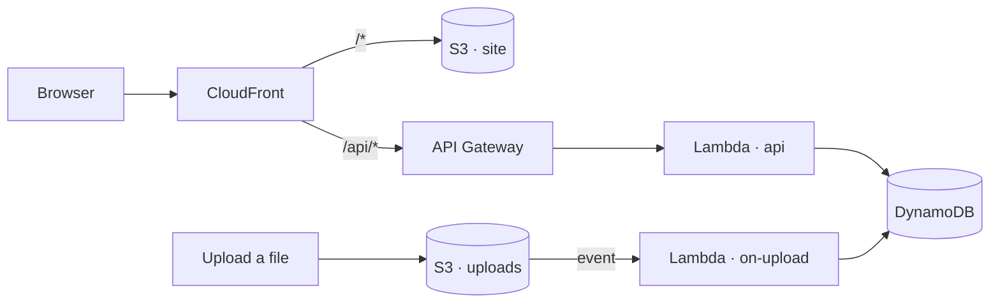

# Lab 07 · Capstone: grow your website into an app with the CDK

> One CDK stack, three stages. The same personal website gets a back end, then an event trigger,
> and the page shows which stage is live.
> Time: 60 minutes · Cost: ≈ $0 at class traffic



| Stage | Adds | The page shows |
|-------|------|----------------|
| 1 | S3 + CloudFront, security headers, 404 page | The static site |
| 2 | DynamoDB, Lambda, HTTP API (throttled), `/api/*` behavior | Visitor counter + guestbook |
| 3 | Uploads bucket + a Lambda triggered by S3 | "Latest uploads" list |

Code: [`lambda/api`](lambda/api/index.mjs) · [`lambda/on-upload`](lambda/on-upload/index.mjs) ·
stack: [`cdk/lib/lab07-capstone-stack.ts`](../../cdk/lib/lab07-capstone-stack.ts) · website: [`site/`](../../site/)

**You'll learn:** how labs 01–04 fit together · one domain for site and API (no CORS) ·
single-table DynamoDB design · `cdk diff` before every change · tearing everything down with one command.

## Run it

```bash
cd cdk
npx cdk deploy Lab07Capstone -c stage=1      # the site (CloudFront takes a few minutes the first time)

npx cdk diff   Lab07Capstone -c stage=2      # read what will be added
npx cdk deploy Lab07Capstone -c stage=2      # counter + guestbook

npx cdk diff   Lab07Capstone -c stage=3
npx cdk deploy Lab07Capstone -c stage=3      # upload trigger
```

## Test it

- Open `WebsiteUrl`: the "How this site is built" panel marks each live stage.
- Stage 2: sign the guestbook from your phone; see the items in **DynamoDB** → `TableName` output → **Explore items**.
  Live logs: `aws logs tail <ApiLogGroup> --follow`.
- Stage 3: `aws s3 cp photo.jpg s3://<UploadsBucketName>/` → the file appears on the page within 5 seconds;
  `aws logs tail <OnUploadLogGroup> --follow` shows `New upload: photo.jpg`.

## Make it yours

Every place to personalise in `site/index.html` is marked `<!-- EDIT -->`. Redeploy with the same stage.

## Fix it

| You see | Fix |
|---------|-----|
| `Request failed (404)` right after stage 2 | CloudFront is rolling out `/api/*`; wait a minute |
| `Something went wrong` | `aws logs tail <ApiLogGroup>` shows the real error |
| Old page after deploy | Wait a minute; the deploy clears the CloudFront cache |
| `This stack uses assets` | `npx cdk bootstrap` |

## Clean up

```bash
npx cdk destroy Lab07Capstone
```

## Go further

- Add lab 08's "ask me" assistant to the page.
- Add sign-in with **Cognito** so only signed-in users can post.
- Ask your agent: *"Run a Well-Architected review of cdk/lib/lab07-capstone-stack.ts and fix the top two risks."*
