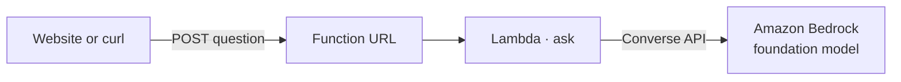

# Lab 08 · Add AI to your product: Lambda + Amazon Bedrock

> An "ask me" assistant for your website: send a question, get a short answer from a foundation model,
> grounded in a few facts about you.
> Time: 30 minutes · Cost: cents (Nova Micro is one of the cheapest models; answers are capped at 300 tokens)



**You'll learn:** foundation models and inference profiles · the Bedrock Converse API · system prompts and
grounding · tokens and cost control (max tokens, reserved concurrency) · IAM for AI services.

Code: [`src/lambda_function.py`](src/lambda_function.py)

## Before you start: pick a model

**Bedrock** → **Model catalog** → filter by your Region → open **Amazon Nova Micro** (or another text model) →
copy its **model ID** or **inference profile ID**. Examples: `us.amazon.nova-micro-v1:0`, `eu.amazon.nova-micro-v1:0`.
Try it once in the **Playground** (that's also a $20 Free Tier credit activity).

## Path A · Console

1. **Lambda** → create `ask` (Python 3.13, arm64) → paste [`src/lambda_function.py`](src/lambda_function.py) → **Deploy**.
2. **Configuration** → **General**: memory 256 MB, timeout 30 s. **Concurrency** → reserve **2**.
3. **Environment variables:** `MODEL_ID` = the ID you copied · `SITE_CONTEXT` = two or three sentences about you.
4. **Permissions** → role → inline policy:
   ```json
   {
     "Version": "2012-10-17",
     "Statement": [{
       "Effect": "Allow",
       "Action": "bedrock:InvokeModel",
       "Resource": ["arn:aws:bedrock:*::foundation-model/*", "arn:aws:bedrock:*:<account-id>:inference-profile/*"]
     }]
   }
   ```
5. **Test** with `{ "question": "What does this person build?" }`.
6. **Function URL** (auth NONE, CORS: origin `*`, method POST, header `content-type`).

## Path B · CloudFormation

```bash
python scripts/deploy_cfn.py labs/08-ai-bedrock/cloudformation/ai-bedrock.yaml lab08-ask \
  ModelId=eu.amazon.nova-micro-v1:0 SiteContext="Dana studies computer science and builds apps on AWS."
```

## Path C · CDK

```bash
cd cdk && npx cdk deploy Lab08AiBedrock -c modelId=eu.amazon.nova-micro-v1:0 -c siteContext="Dana builds apps on AWS."
```

## Test it

```bash
curl -s -X POST <AskUrl> -H 'content-type: application/json' -d '{"question":"What does Dana build?"}'
```
The log line shows the tokens used per answer: that's what you pay for.

## Fix it

| You see | Cause | Fix |
|---------|-------|-----|
| `ValidationException ... model identifier is invalid` | Model ID not available in your Region | Copy the ID from the model catalog in *your* Region; try the `us.` / `eu.` inference profile |
| `AccessDeniedException ... bedrock:InvokeModel` | Role policy missing | Step 4 |
| `AccessDeniedException ... model access` | The model needs a one-time use-case form (some providers) | Open the model in the catalog and submit the form, or use Amazon Nova |
| `ThrottlingException` | Too many requests | Normal under load; reserved concurrency keeps it small |
| Timeout | Long answers | Keep `maxTokens` low; raise the timeout |

## Clean up

```bash
aws cloudformation delete-stack --stack-name lab08-ask
npx cdk destroy Lab08AiBedrock
```

## Go further

- Add an "Ask me" box to `site/index.html` that POSTs to the URL.
- Protect the URL: put it behind CloudFront and API Gateway with throttling, or require sign-in.
- Stream the answer word by word with `ConverseStreamCommand`.
