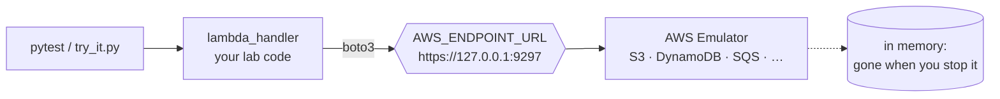

# Lab 09 · AWS on your laptop: test with AWS Emulator

> Run S3, DynamoDB and SQS on your own machine, run your Lambda code against them, and test it
> with no AWS account, no deploy and no bill.
> Time: 45 minutes · Cost: $0 (nothing is created in AWS)



**You'll learn:** what an emulator is (and how it differs from a mock) · pointing the AWS CLI and boto3 at
another endpoint with environment variables · running Lambda code locally · integration tests ·
a safety guard so tests can never reach your real account · the emulator's limits.

AWS Emulator is an official, free, open-source AWS tool (released November 2026). It runs AWS APIs
locally, generated from the same API models as the SDKs, so requests are validated and errors look like AWS.
Always account `000000000000`. Everything lives in memory and disappears when you stop it.

Files: [`emulator-env.sh`](emulator-env.sh) · [`emulator-env.ps1`](emulator-env.ps1) · [`Dockerfile`](Dockerfile) ·
[`guard.py`](guard.py) · [`try_it.py`](try_it.py) · tests: [`tests/integration/`](../../tests/integration/)

## 1. Install and start it (pick one)

**Easiest: with your coding agent.** Needs AWS CLI 2.35 or later.

```bash
aws agent-toolkit add-skill --skill-name aws-emulator --region us-east-1
```

Then ask your agent: *"Install AWS Emulator, start it, and point this project at it."*

**Linux (Ubuntu / Debian, Intel or AMD):**

```bash
curl -fsSLo aws-emulator.deb https://downloads.aws.com/aws-emulator/packages/aws-emulator/LTS/latest/aws-emulator_amd64.deb
sudo apt-get install -y ./aws-emulator.deb
aws-emulator --telemetry off          # keep this terminal open
```

Arm: `aws-emulator_arm64.deb`. Amazon Linux / Fedora: `sudo dnf install -y <the .rpm URL>` (see the user guide).

**macOS and Windows: Docker** (there is no published image, you build it once from [`Dockerfile`](Dockerfile)):

```bash
# Intel / AMD                          # Apple silicon: add --build-arg ARCH=aarch64
docker build -t aws-emulator labs/09-aws-emulator
mkdir -p ~/.aws/emulator
docker run --rm --memory=2g --memory-swap=2g -p 127.0.0.1:9297:9297 \
  -e HOME="$HOME" -v "$HOME/.aws/emulator:$HOME/.aws/emulator" \
  aws-emulator -p 9297 --telemetry off
```

Windows PowerShell (create the folder first: `New-Item -ItemType Directory -Force "$env:USERPROFILE\.aws\emulator"`):

```powershell
docker run --rm --memory=2g --memory-swap=2g -p "127.0.0.1:9297:9297" `
  -v "$env:USERPROFILE\.aws\emulator:/home/emulator/.aws/emulator" `
  aws-emulator -p 9297 --telemetry off
```

Keep `127.0.0.1:` in the port mapping, or Docker exposes the emulator to your whole network.
On start it writes fresh keys, a config file and a certificate to `~/.aws/emulator/9297/`.

## 2. Point a terminal at it

Open a **second** terminal in the repository and activate your virtual environment, then:

```bash
source labs/09-aws-emulator/emulator-env.sh        # Windows: . .\labs\09-aws-emulator\emulator-env.ps1
aws sts get-caller-identity                        # "Account": "000000000000"
```

`000000000000` means you are on the emulator. **If you ever see your real account ID, stop.**
The script also unsets any real keys in this terminal, so nothing can leak to AWS.

## 3. Use AWS as usual, with the CLI

```bash
aws s3 mb s3://my-first-bucket
echo "hello" > hello.txt && aws s3 cp hello.txt s3://my-first-bucket/
aws s3 ls s3://my-first-bucket
aws dynamodb create-table --table-name notes --billing-mode PAY_PER_REQUEST \
  --attribute-definitions AttributeName=id,AttributeType=S --key-schema AttributeName=id,KeyType=HASH
aws dynamodb list-tables
aws sqs create-queue --queue-name orders
```

Same commands as on AWS: only the endpoint changed.

## 4. The same from Python, then your own Lambda code

```bash
python labs/09-aws-emulator/try_it.py
```

[`try_it.py`](try_it.py) creates a bucket, a table and a queue with boto3, then runs the **lab 03
`lambda_handler`** on your laptop: it creates a note in the emulated DynamoDB table and lists it back.
Read the code: there is no endpoint and no key in it. boto3 reads them from the environment, exactly
like inside Lambda.

## 5. Integration tests

```bash
pytest tests/integration -v
```

| Test | What it proves on real (emulated) APIs |
|------|----------------------------------------|
| `test_lab03_notes_crud_on_dynamodb` | Lab 03 creates, reads, lists and deletes notes |
| `test_lab07_counter_guestbook_and_uploads` | The atomic counter, newest-first Query, and the S3 trigger code |
| `test_lab04_sqs_batch_with_one_bad_message` | Only the bad SQS message is reported for retry |
| `test_lab04_upload_notification` | S3 metadata + SNS publish (skipped if SNS isn't available) |
| `test_the_emulator_rejects_what_aws_rejects` | Real error codes: `ResourceNotFoundException`, `NoSuchKey` |

Unit tests vs integration tests: the unit tests in `tests/` replace AWS with fakes you wrote, so they
only check what you expected. Here the emulator validates every request and keeps state, so a wrong
key name, a missing table or a bad query fails like it would on AWS.

Without `AWS_ENDPOINT_URL` these tests are skipped, so plain `pytest` stays fast and offline.
With it, [`guard.py`](guard.py) first checks the endpoint is your machine **and** the account is
`000000000000`; otherwise every test fails before touching anything.

**In CI:** [`.github/workflows/emulator.yml`](../../.github/workflows/emulator.yml) installs the emulator on the
GitHub runner and runs these tests. Start it from the **Actions** tab; no AWS credentials are stored anywhere.

## 6. With your coding agent

With the `aws-emulator` skill installed, try:

> Start AWS Emulator, then write an integration test for labs/04-event-triggers/src/daily-report
> that uploads three files and checks the report. Run it against the emulator only.

The agent can write, run and fix AWS code in a loop without any access to your account.
Run one emulator per agent, each on its own port: `aws-emulator -p 9298` and
`source labs/09-aws-emulator/emulator-env.sh 9298`.

## Know the limits

| Limit | What it means for you |
|-------|----------------------|
| Dev and test only | Never production, never real data |
| IAM policies are not evaluated like AWS | A request AWS would deny may succeed: test permissions on AWS (labs 02–08) |
| Fidelity varies by service | Check the scores on the [releases page](https://github.com/aws/aws-emulator/releases) |
| Unimplemented operations | Return HTTP 501 `NotImplemented` |
| One account, one Region per emulator | Run a second emulator on another port for a second Region |
| In memory only | Stop it and everything is gone (that's also your clean state) |
| Bedrock `converse` | Returns a fixed message: no model runs |

## Fix it

| You see | Cause | Fix |
|---------|-------|-----|
| `Could not connect to the endpoint URL` | Emulator not running, or wrong port | Start it; same port in `emulator-env.sh` |
| `SSL: CERTIFICATE_VERIFY_FAILED` | `AWS_CA_BUNDLE` not set, or emulator restarted in another terminal | `source emulator-env.sh` again |
| `InvalidClientTokenId` / `UnrecognizedClientException` | Old keys: the emulator makes new ones on every start | `source emulator-env.sh` again |
| Your real account ID in `get-caller-identity` | This terminal isn't pointed at the emulator | `source emulator-env.sh`; never run tests here |
| S3 errors with a bucket name in the host | Used `localhost` | Use `127.0.0.1` (the script does) |
| `NotImplemented` (501) | That operation isn't emulated yet | Check the fidelity report; test that part on AWS |
| Docker: `I/O error (os error 1)` | File permissions on the mounted folder (Linux, Rancher) | Add `--user "$(id -u):$(id -g)"` to `docker run` |

## Clean up

Press **Ctrl+C** in the emulator's terminal. It deletes its files in `~/.aws/emulator/9297/` and everything
you created. Close the second terminal so it forgets the emulator settings. Nothing to delete in AWS.

Sources: [AWS Emulator user guide](https://docs.aws.amazon.com/emulator/latest/userguide/) ·
[AWS News Blog launch post](https://aws.amazon.com/blogs/aws/test-your-applications-against-aws-locally-with-aws-emulator/) ·
[github.com/aws/aws-emulator](https://github.com/aws/aws-emulator)
