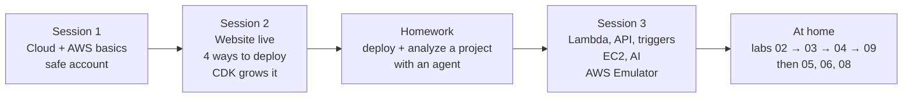

# The workshop: 3 sessions, 3 hours each

The flow for each session: what to do minute by minute, the exact commands, the checkpoints, and what
to do when something breaks. Slide numbers refer to the course deck (110 slides).

| Session | Goal | Hands-on | Live demos | Guide |
|---------|------|----------|------------|-------|
| 1 | Understand the cloud and AWS's core services; set up a safe account | MFA and a budget alert | Console tour | slides 1–40 |
| 2 | Put a website live on AWS, then grow it into an app | Website on S3 + CloudFront (console) | `deploy.py`, Amplify, CDK `Lab07Capstone` stages 1–3 | [session-2.md](session-2.md) |
| 3 | Build back-end pieces, test them on your laptop, go further | Lab 02 (first Lambda), Lab 09 (AWS Emulator) | Labs 03, 04, 06, 08, an agent writing a test | [session-3.md](session-3.md) |



## What students need

| Before | Need |
|--------|------|
| Session 2 | An AWS account with MFA and a budget alert (session 1), a modern browser, their own `index.html` (optional) |
| Session 3 | A fork of this repo, Python 3.11+, `pytest` passing, AWS CLI 2.35+ with `aws login` working; Docker on Mac or Windows for the emulator lab |

## No laptop setup? Use AWS CloudShell

Every lab also runs in **AWS CloudShell**, the terminal inside the AWS console (icon at the bottom left, or
the `>_` icon at the top). It already has Python, Node.js, git and the AWS CLI, and it uses your console
sign-in, so there are no access keys to create or paste:

```bash
git clone https://github.com/mkabajah/AWS-Workshop.git && cd AWS-Workshop
python3 -m venv /tmp/venv && source /tmp/venv/bin/activate
pip install -r requirements-dev.txt -r cdk/requirements.txt && pytest
export JSII_RUNTIME_PACKAGE_CACHE=disabled     # CloudShell needs this for the Python CDK
cd cdk && npm install && npx cdk bootstrap
npx cdk deploy Lab02LambdaBasics
```

Keep the virtual environment in `/tmp` (the home folder has only 1 GB). Lab 09 (AWS Emulator) still needs a
laptop or Docker.

## Cost rules for every session

- Labs 01–04, 07, 08 fit inside the AWS credits.
- Labs 05 and 06 cost money **every hour** they run: build, learn, `cdk destroy` the same day.
- Lab 09 runs on your laptop: nothing is created in AWS.
- Every guide ends with a clean-up checklist. Do it before you leave the room.
