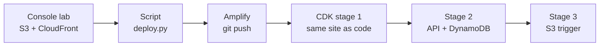

# Session 2 · Host and grow your website

Every student puts their website live on AWS by hand, then watches it deployed three more ways and
grown into an app with the Python CDK. 3 hours, slides 41–66 and 104–108.

Students build only the console version themselves; everything after the lab is a live demo from this
repo, which they clone before Session 3.

## At a glance

| Time | Block | Slides | You | Students |
|------|-------|--------|-----|----------|
| 0:00–0:10 | Welcome and recap | none | Ask the 6 recap questions, check sign-in | Answer, sign in to the console |
| 0:10–0:25 | Today's plan and why | 41–44 | Roadmap, private bucket + CloudFront, static vs dynamic | Listen, ask |
| 0:25–1:05 | **Lab: website in the console** | 45–51 | Each step once on screen, then walk the room | Build their own site |
| 1:05–1:20 | Demo: script and Amplify | 52–54 | `deploy.py`, then `git push` to Amplify | Watch |
| 1:20–1:30 | **Break** | | Check Amplify build, stage 1 is live | |
| 1:30–1:50 | Infrastructure as code | 55–58 | Why code, CloudFormation vs CDK, the Python stack | Ask |
| 1:50–2:30 | **CDK demo: grow the site** | 59–63 | `Lab07Capstone` stages 1 → 2 → 3, `cdk diff` first | Sign the guestbook on their phones |
| 2:30–2:40 | Four ways to run an app | 64–66 | A serverless app vs an EC2 app, compared | Listen |
| 2:40–2:55 | Homework | 104–108 | Brief, steps, prompts, what to submit | Note the due date |
| 2:55–3:00 | Before next time + Q&A | 82, 110 | Clone the repo and run `pytest` at home | Ask |



## Before the session

The one thing that can sink the demo is waiting for CloudFront in front of the class, so stage 1 is
deployed the evening before.

**The evening before**

- [ ] The repo is on GitHub and the CI run is green
- [ ] Put your name and two lines about yourself in `site/index.html`, commit, push
- [ ] Python ready: `python -m venv .venv && source .venv/bin/activate && pip install -r requirements-dev.txt && pytest` (23 passed, 5 skipped)
- [ ] Sign in and set the Region: `aws login`, `aws configure set region <course Region>`, `aws sts get-caller-identity`
- [ ] CDK ready: `cd cdk && pip install -r requirements.txt && npm install && npx cdk bootstrap`
- [ ] Deploy stage 1: `npx cdk deploy Lab07Capstone -c stage=1`, open the `WebsiteUrl` output: the page says "deployed with AWS CDK"
- [ ] Dry run stages 2 and 3, then go back with `npx cdk deploy Lab07Capstone -c stage=1` so the class sees the site grow
- [ ] Amplify: connect the GitHub repo in the Amplify console (monorepo, app root `site`), or keep a zip of `site/` for Deploy without Git
- [ ] Do the console lab yourself once and keep that bucket name and distribution ID for the script demo
- [ ] Share with students: the course hub, the deck and the Lab 1 handout

**One hour before**

- [ ] Tabs open: the deck, the console (S3, CloudFront, CloudFormation, DynamoDB, Amplify), the stage 1 website, the repo on GitHub
- [ ] Two terminals in `cdk/` with the virtual environment active, font large enough for the back row
- [ ] A `photo.jpg` on the desktop for the stage 3 upload
- [ ] Phone hotspot ready in case the room network blocks anything
- [ ] Write the course hub link on the board

## Step by step

Each block lists what to say, what to run and a checkpoint. The speaker notes on every slide have the
same points, with your actions in parentheses.

### 1. Welcome and recap · 0:00–0:10 · no slides

Ask the room, wait for answers, correct gently:

1. What is a Region, and what is an Availability Zone? *(A place in the world; separate data centers inside it.)*
2. What does S3 store, and what does CloudFront do? *(Files; serves them fast, over HTTPS, near the user.)*
3. Why keep the bucket private? *(Only CloudFront should read it.)*
4. Who patches the server on EC2, and on Lambda? *(You; AWS.)*
5. What does IAM decide? *(Who may do what, on which resource.)*
6. What did you set up first in your account? *(MFA and a budget alert.)*

**Checkpoint:** everyone can sign in and sees the course Region at the top right. Anyone without an
account pairs with a neighbour.

### 2. Today's plan and why · 0:10–0:25 · slides 41–44

- Slide 42: "One website today, deployed four ways, then grown into an app. You build the first version yourself."
- Slide 43: the bucket stays private; visitors only talk to CloudFront.
- Slide 44: a static site runs in the browser; anything that saves data needs Lambda or a server. Ours gets a back end later today.

### 3. Lab: website in the console · 0:25–1:05 · slides 45–51

Students follow Level 1 of the Lab 1 handout (and [`labs/01-static-website`](../labs/01-static-website/)) with you.

1. **Bucket (46–47):** do it on screen, wait until most hands are up. Keep Block all public access on.
2. **Upload:** `index.html` at the top of the bucket: their own page, or [`site/`](../site/) from the repo.
3. **CloudFront (48–50):** Free plan, origin = their bucket, keep "Allow private S3 bucket access" ticked. Start it early: it takes minutes.
4. While distributions deploy, explain slide 51 and walk the room.

**Checkpoint (51):** the site loads on `https://…cloudfront.net`, and the S3 object URL says Access
Denied. Check both for each student.

### 4. Demo: script and Amplify · 1:05–1:20 · slides 52–54

- **Slide 52:** the four ways, from clicking to code.
- **Slide 53:** change the headline in `site/index.html`, then:

```bash
python labs/01-static-website/cli/deploy.py <your-bucket-name> <your-distribution-id>
```

Refresh the site. Point at the output: only changed files upload, then one invalidation. Say: "Updates
are one command now, but the bucket and distribution were still clicked by hand."

- **Slide 54:** show the connected repo in Amplify, edit the headline, `git push`, let the build run
  during the break. Keep it to 5 minutes.

### 5. Break · 1:20–1:30

Check the Amplify build finished. Check the CDK site is still at stage 1.

### 6. Infrastructure as code · 1:30–1:50 · slides 55–58

- Slide 55: "Could you click those 15 settings again, exactly, tomorrow?"
- Slide 56: CloudFormation does the deploying; the CDK writes the template for you, here in Python.
- Slide 57: the lab they just did, as 10 lines of Python.
- Slide 58: the loop: synth, diff, deploy, destroy.

Go slowly. This is the hardest idea of the day.

### 7. CDK demo: grow the site · 1:50–2:30 · slides 59–63

Two terminals in `cdk/`, virtual environment active, large font.

1. **Stage 1 (59):** open [`cdk/stacks/lab07_capstone.py`](../cdk/stacks/lab07_capstone.py), read the
   stage 1 block. Open the `WebsiteUrl` output and the stack in CloudFormation. Point out the security
   headers and the custom 404 page.
2. **Stage 2 (60):**

```bash
npx cdk diff Lab07Capstone -c stage=2
npx cdk deploy Lab07Capstone -c stage=2
aws logs tail <ApiLogGroup output> --follow
```

Read the diff with the class first. Point at `table.grant_read_write_data(api_function)`: one line of
least privilege. When it's live, everyone opens the URL on their phone and signs the guestbook. Show
DynamoDB → Explore items.

3. **Stage 3 (61):**

```bash
npx cdk diff Lab07Capstone -c stage=3
npx cdk deploy Lab07Capstone -c stage=3
aws logs tail <OnUploadLogGroup output> --follow                 # terminal 1
aws s3 cp ~/Desktop/photo.jpg s3://<UploadsBucketName output>/    # terminal 2
```

Say: "Nobody called that function. S3 did." The page's Latest uploads list shows the file within seconds.

4. **Why code wins (62–63):** run `npx cdk diff Lab07Capstone -c stage=1` to show what would be
   removed. Leave `cdk destroy` for after class.

**Checkpoint:** the class has signed the guestbook and seen the upload appear live.

### 8. Four ways to run an app · 2:30–2:40 · slides 64–66

A serverless app vs an EC2 app, and how to choose. If you're late, skip: Lab 06 covers EC2 in Session 3.

### 9. Homework · 2:40–2:55 · slides 104–108

Jump to slide 104. Homework: deploy and analyze a GitHub project (their personal website or the hiring
system) with their agent and the AWS skills, due at the start of Session 3. Walk the steps (106), the
prompts (107) and what to submit (108).

### 10. Before next time + Q&A · 2:55–3:00 · slides 82, 110

Show slide 82: fork this repo, make a virtual environment, `pip install -r requirements-dev.txt`,
`pytest`. Ask everyone to have Python 3.11+ and the AWS CLI working before Session 3. Optional:
install Docker for the emulator lab.

## If something goes wrong

Keep the demo moving: every problem below has a fallback that still makes the point.

| Problem | What to do |
|---------|------------|
| A student's CloudFront takes long to deploy | Move on; check theirs during the script demo. Pair them with a neighbour |
| A student has an old AWS account (no credits) | Budget alert first, then the lab, or pair up |
| Site shows AccessDenied at the root | Distribution → Settings → Default root object = `index.html` |
| `deploy.py` says `NoSuchBucket` or `AccessDenied` | Wrong bucket name or Region: copy it from the S3 console; check `aws sts get-caller-identity` |
| `cdk deploy` waits on CloudFront for minutes | Talk through the diff and the Python code while it runs; normal for CloudFront |
| CDK can't find credentials | `eval "$(aws configure export-credentials --format env)"` in that terminal |
| `No module named aws_cdk` | Virtual environment not active in that terminal: `source .venv/bin/activate` |
| Guestbook says "Request failed (404)" after stage 2 | CloudFront is still rolling out `/api/*`; wait a minute, refresh |
| "Something went wrong" from the API | `aws logs tail <ApiLogGroup output>` shows the real error |
| Room network blocks the console or GitHub | Phone hotspot. Skip Amplify if needed; it's the least important step |
| Running out of time | Skip slides 64–66, keep stage 3: the event trigger is the highlight |

## After the session

Delete what you deployed tonight so nothing keeps running, then send students what they need for the
homework and Session 3.

**Clean up**

- [ ] `cd cdk && npx cdk destroy Lab07Capstone` (every CDK resource, buckets included)
- [ ] Console demo: empty and delete the bucket, disable then delete the distribution
- [ ] Amplify: App settings → General → Delete app
- [ ] Billing: check month-to-date charges and remaining credits

**Send students**

- [ ] The course hub link, with the deck, the Lab 1 handout and this repo
- [ ] Finish Level 1 if they didn't; delete what they created
- [ ] Before Session 3: fork the repo, `pip install -r requirements-dev.txt`, `pytest` passes; AWS CLI 2.35+ with `aws login` working; Docker or Linux if they want to follow the emulator lab live
- [ ] The homework brief and its due date
