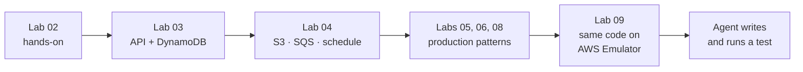

# Session 3 · Build, test locally, and go further

Students build their first Lambda function, watch the API and triggers labs deploy with the CDK, run
the same code on AWS Emulator with no account, then finish with agents, certifications and a recap.
3 hours, slides 67–103 and 109–110.

Two hands-on blocks carry this session: Lab 02 in the console, and Lab 09 on AWS Emulator. The other
labs are short live demos from stacks you deploy beforehand.

## At a glance

| Time | Block | Slides | You | Students |
|------|-------|--------|-----|----------|
| 0:00–0:15 | Homework show-and-tell | none | 2–3 students show their deployed project | Present, ask |
| 0:15–0:25 | The labs repo | 67–69, 82 | Ten labs, three paths, how to run it | Open their fork |
| 0:25–0:55 | **Lab 02: first Lambda function** | 70 | Build it on screen, then walk the room | Build it in the console |
| 0:55–1:15 | Demo: API and triggers | 71–72 | `Lab03ApiDynamoDb`, `Lab04EventTriggers` | Watch the email arrive |
| 1:15–1:30 | Production patterns | 73–76 | RDS, EC2 self-healing, fixes, AI | Ask |
| 1:30–1:40 | **Break** | | Start the emulator | |
| 1:40–2:20 | **Lab 09: AWS Emulator** | 77–81 | Concept, then the full lab live | Follow along (Linux or Docker) |
| 2:20–2:35 | Agents | 83–88 | Agent + `aws-emulator` skill writes and runs a test | Watch |
| 2:35–2:50 | Certifications | 89–102 | Fast tour, then the two quiz slides | Answer the quiz |
| 2:50–3:00 | Recap and close | 103, 109–110 | Recap, resources, Q&A | Ask |



## Before the session

Deploy the demo stacks ahead so nobody waits, and run the emulator lab once end to end on the laptop
you will present from.

**The evening before**

- [ ] `git pull`, virtual environment active, `pytest` passes
- [ ] `cd cdk && npx cdk deploy Lab04EventTriggers -c email=<your email>`, then click **Confirm subscription** in the email from AWS
- [ ] Test Lab 04 once: upload a file to the `UploadsBucket` output, check the email arrives
- [ ] Install AWS Emulator: Linux `.deb`/`.rpm`, or `docker build -t aws-emulator labs/09-aws-emulator` (Apple silicon: `--build-arg ARCH=aarch64`)
- [ ] Full dry run of Lab 09: start it, `source labs/09-aws-emulator/emulator-env.sh`, `aws sts get-caller-identity` (000000000000), `python labs/09-aws-emulator/try_it.py`, `pytest tests/integration -v`. Note which tests pass or skip on your build
- [ ] Agent ready: `aws agent-toolkit add-skill --skill-name aws-emulator --region us-east-1` (AWS CLI 2.35+), plus the AWS core skills from Session 2
- [ ] Optional, Lab 08: Bedrock model access in your Region; note the model ID
- [ ] Ask students to bring: their fork, Python 3.11+, AWS CLI working; Docker if they're on Mac or Windows

**One hour before**

- [ ] `npx cdk deploy Lab06Ec2Website` (serves this repo's `site/`; add `-c repoUrl=<your fork>` for your own; ≈ $0.05/hour; servers need ~5 minutes to pass health checks)
- [ ] Open the `WebsiteUrl` output of Lab 06 and the EC2 console (Instances, Target groups)
- [ ] Tabs: the deck, the Lambda console, CloudWatch Logs, the SQS console, your email
- [ ] Three terminals in the repo, virtual environment active, large font: one for CDK, two for the emulator
- [ ] A small file on the desktop for the Lab 04 upload

## Step by step

Each block lists what to say, what to run and a checkpoint. Run every command from the repository
root unless it says `cdk/`.

### 1. Homework show-and-tell · 0:00–0:15 · no slides

Pick 2–3 students. Each shows the live URL, the architecture diagram and one finding from their
review. Ask the class: "What would it cost at 10,000 visitors a month?"

### 2. The labs repo · 0:15–0:25 · slides 67–69, 82

- Slide 68: ten labs; 05 and 06 cost money per hour, 09 costs nothing.
- Slide 69: same Python code, three ways to build around it.
- Slide 82: fork, clone, `pytest`. Check hands: who has `pytest` passing?

### 3. Lab 02: first Lambda function · 0:25–0:55 · slide 70

Walk slide 70 (handler, event, env vars, role, logs, limits), then everyone builds it in the console,
following [`labs/02-lambda-basics`](../labs/02-lambda-basics/) Path A:

1. Create `hello-lambda`: Python 3.13, arm64, basic role.
2. Paste `src/lambda_function.py` → **Deploy**.
3. Test event `{"name": "Dana"}` → `Hello, Dana!`.
4. Env var `GREETING` = `Marhaba` → test again.
5. Function URL, auth NONE → open it with `?name=YourName`.
6. Monitor → CloudWatch logs: find their `print()` line.

**Checkpoint:** every student's function URL answers with their name in the browser. Then they delete
the function URL (or the function) before leaving.

### 4. Demo: API and triggers · 0:55–1:15 · slides 71–72

Lab 03 deploys in about a minute (no CloudFront), so do it live:

```bash
cd cdk
npx cdk deploy Lab03ApiDynamoDb
curl -X POST <ApiUrl>/notes -H 'content-type: application/json' -d '{"title": "From the class"}'
curl <ApiUrl>/notes
```

Show the item in DynamoDB → Explore items. Point at `grant_read_write_data` in
[`cdk/stacks/lab03_api_dynamodb.py`](../cdk/stacks/lab03_api_dynamodb.py).

Lab 04 is already deployed. Show the three triggers:

```bash
aws s3 cp ~/Desktop/<file> s3://<UploadsBucket output>/     # the email arrives in seconds
aws sqs send-message --queue-url <OrdersQueueUrl> --message-body file://labs/04-event-triggers/events/order-good.json
aws sqs send-message --queue-url <OrdersQueueUrl> --message-body file://labs/04-event-triggers/events/order-bad.json
```

The bad order retries 3 times (60-second visibility timeout), so it reaches the dead-letter queue about
3 minutes later: check `DeadLetterQueueUrl` at the end of block 5. For the schedule, invoke
`DailyReport` with the Test button in the Lambda console.

### 5. Production patterns · 1:15–1:30 · slides 73–76

- **73, RDS:** talk only (it costs per hour). The point: private subnets, security groups that reference each other, the password in Secrets Manager.
- **74, EC2:** open the Lab 06 `WebsiteUrl`. In the EC2 console, **terminate one instance**. Refresh the site: it stays up. Within minutes Auto Scaling starts a new one. This is the best demo of the course.
- **75, fixes:** the five errors; first move is always the logs.
- **76, AI:** if Bedrock access is ready, `npx cdk deploy Lab08AiBedrock -c modelId=<your model ID>` and ask it one question with `curl`; otherwise walk the slide.

Back to Lab 04: the DLQ now shows 1 message.

### 6. Break · 1:30–1:40

Start the emulator in terminal 1 so it's ready.

### 7. Lab 09: AWS Emulator · 1:40–2:20 · slides 77–81

**Concept (77–80, 10 minutes):** same code, one endpoint swap; account `000000000000`; mock vs
emulator; the limits (IAM isn't evaluated like AWS).

**Live (81, 30 minutes):** follow [`labs/09-aws-emulator`](../labs/09-aws-emulator/); students on Linux
or Docker follow along.

```bash
# terminal 1 (Linux)          Mac / Windows: the docker run command from the lab README
aws-emulator --telemetry off

# terminal 2
source labs/09-aws-emulator/emulator-env.sh
aws sts get-caller-identity           # "Account": "000000000000"
aws s3 mb s3://class-demo
aws dynamodb list-tables
python labs/09-aws-emulator/try_it.py
pytest tests/integration -v
```

Point out three things:

1. `try_it.py` runs the **lab 03 `lambda_handler`** against the emulated DynamoDB, with no endpoint or key in the code.
2. `guard.py`: the tests refuse to run unless the account is 000000000000. Show it: in terminal 3 (not pointed at the emulator), `pytest tests/integration` skips everything.
3. Stop the emulator with Ctrl+C, run `aws s3 ls` in terminal 2: it fails. Everything was in memory; nothing to clean up, nothing to pay.

**Checkpoint:** at least the students on Linux or Docker see `000000000000` and a green `try_it.py`.
Everyone else does it at home from the README.

### 8. Agents · 2:20–2:35 · slides 83–88

With the emulator running again and the `aws-emulator` skill installed, ask your agent live:

> Start AWS Emulator if it isn't running, then write an integration test for
> labs/04-event-triggers/src/daily-report that uploads three files and checks the report.
> Run it against the emulator only.

Read its test with the class before it runs. The point: agents can write, run and fix AWS code in a
loop with no access to your account.

### 9. Certifications · 2:35–2:50 · slides 89–102

Fast: levels and paths (90–91), the Cloud Practitioner exam (92), Well-Architected (93), one slide per
category (94–100), then the quiz (101–102) with hands up.

### 10. Recap and close · 2:50–3:00 · slides 103, 109–110

Recap, resources, Q&A. Remind everyone: delete anything they created today.

## If something goes wrong

| Problem | What to do |
|---------|------------|
| Lab 02: `Unable to import module 'lambda_function'` | Handler must be `lambda_function.lambda_handler`; file name unchanged |
| Function URL says Forbidden | Auth type NONE, and wait 10 seconds after saving |
| Lab 04 email never arrives | Subscription not confirmed: check spam for the AWS confirmation email |
| `cdk deploy` can't find credentials | `eval "$(aws configure export-credentials --format env)"` in that terminal |
| Lab 06 site says 502 / 503 | Servers still starting; target group health checks pass after ~5 minutes |
| Bedrock `AccessDeniedException` | Model access not enabled or wrong model ID for the Region: skip, walk slide 76 |
| Emulator: `Could not connect to the endpoint URL` | It isn't running, or the port differs: restart terminal 1 |
| Emulator: `CERTIFICATE_VERIFY_FAILED` or `InvalidClientTokenId` | The emulator restarted with new keys: `source labs/09-aws-emulator/emulator-env.sh` again |
| `get-caller-identity` shows your real account | That terminal isn't pointed at the emulator. Stop and `source` the script; the tests refuse to run anyway |
| A test fails with `NotImplemented` (501) | That operation isn't emulated in this build: say so, it's the fidelity limit from slide 80 |
| Students on Windows/Mac without Docker | Pair them with a Linux or Docker neighbour; they repeat it at home |
| Running out of time | Shorten certifications to the quiz (101–102); keep the EC2 terminate demo and the emulator |

## After the session

Lab 06 costs money every hour, so destroy it before you leave the room.

**Clean up**

- [ ] `cd cdk && npx cdk destroy Lab06Ec2Website`
- [ ] `npx cdk destroy Lab03ApiDynamoDb` and `npx cdk destroy Lab04EventTriggers` (and `Lab08AiBedrock` if you deployed it)
- [ ] Lambda console: delete your `hello-lambda` demo function
- [ ] Ctrl+C the emulator (it deletes its own files and state)
- [ ] Billing: check month-to-date charges and remaining credits

**Send students**

- [ ] This repo and the order to try the labs at home: 02 → 03 → 04 → 09, then 05, 06, 08 one at a time
- [ ] The rule for labs 05 and 06: build, learn, `cdk destroy` the same day
- [ ] The certification links from slide 109 and the Cloud Practitioner exam page
- [ ] A reminder to delete their own Lab 02 function and anything else they created
